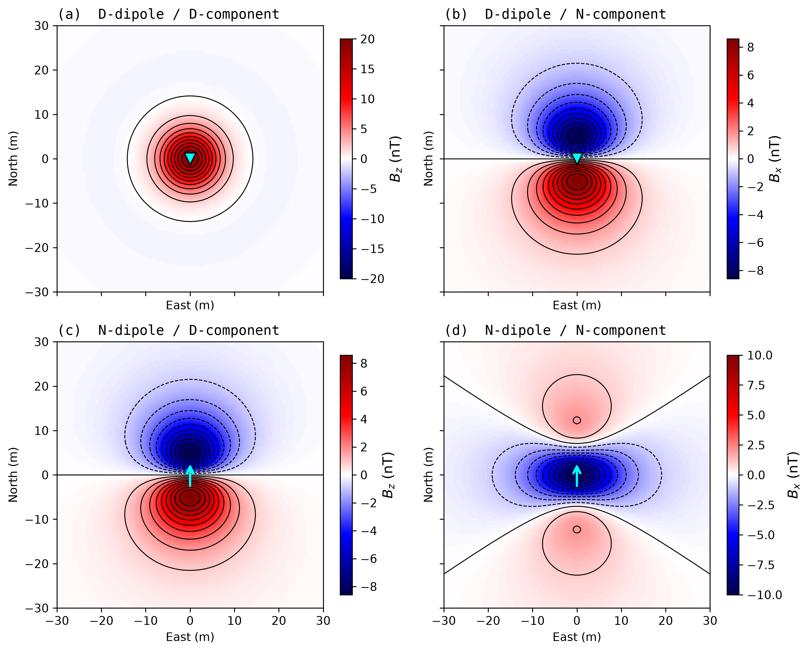

## Cartesian dipole anomalies on a horizontal plane — four cases

**Setup**

- NED coordinates: $x$ = North, $y$ = East, $z$ = Down.
- Dipole at $\mathbf{r}_0=(0,0,d)$ with $d=10\;\mathrm{m}$; observation plane $z=0$.
- Relative vector $\mathbf{r}=(x,y,-d)$, $r^2=\rho^2+d^2$, $\rho^2=x^2+y^2$.
- SI dipole field (output in nT by `dipole_field`):

  $$\mathbf{B}=\frac{\mu_0}{4\pi}\,\frac{3(\mathbf{m}\cdot\mathbf{r})\,\mathbf{r}-\mathbf{m}\,r^2}{r^5}$$

  with $C\equiv\dfrac{\mu_0M}{4\pi}=10^{-5}\;\mathrm{nT\cdot m^3}$ for $M=100\;\mathrm{A\,m^2}$.

---

### (a) D-dipole / D-component  —  $\mathbf{m}=(0,0,M)$,  $B_z$

$$\boxed{B_z=\frac{\mu_0M}{4\pi}\,\frac{2d^2-\rho^2}{\left(\rho^2+d^2\right)^{5/2}}}$$

- **Axisymmetric** (depends only on $\rho$). Central positive anomaly surrounded by a negative ring.
- Maximum at centre: $B_z(0)=2C/d^3=+20\;\mathrm{nT}$.
- Zero crossing at $\rho=\sqrt{2}\,d\approx14.1\;\mathrm{m}$.
- Far-field decay $\propto\rho^{-3}$.

> **中文要点**  
> - **形态**：轴对称，中心正异常 + 外围负环带  
> - **中心值**：$B_z(0)=+2C/d^3$（正极大）  
> - **零点**：$\rho=\sqrt{2}\,d$，与埋深成正比  
> - **远场衰减**：$\propto \rho^{-3}$

---

### (b) D-dipole / N-component  —  $\mathbf{m}=(0,0,M)$,  $B_x$

$$\boxed{B_x=-\frac{\mu_0}{4\pi}\,\frac{3Md\,x}{\left(\rho^2+d^2\right)^{5/2}}}$$

- **North–South antisymmetric**, East–West symmetric. The East axis ($x=0$) is always zero.
- Positive south of the origin, negative north — horizontal field converges radially toward the dipole.
- Peak magnitude $\approx0.86\,C/d^3$ (about **43 %** of the $B_z$ centre value).
- Decay $\propto\rho^{-4}$ on the $x$-axis, faster than $B_z$.

> **中文要点**  
> - **形态**：南北反对称，东西轴恒为零  
> - **中心值**：$B_x(0,0)=0$  
> - **零点**：$x=0$（整个东西轴上均为零），由反对称性决定，与埋深 $d$ 无关  
> - **远场衰减**：沿 $x$ 轴 $\propto \rho^{-4}$，比 $B_z$ 更快

---

### (c) N-dipole / D-component  —  $\mathbf{m}=(M,0,0)$,  $B_z$

$$\boxed{B_z=-\frac{\mu_0}{4\pi}\,\frac{3Md\,x}{\left(\rho^2+d^2\right)^{5/2}}}$$

- **Mathematically identical to case (b)** — reciprocity between a horizontal dipole’s vertical component and a vertical dipole’s along-dipole horizontal component.
- Same antisymmetric South-positive / North-negative pattern.

> **中文要点**  
> - **形态**：与 (b) **数学全同**（互易性）  
> - **中心值**：$B_z(0,0)=0$  
> - **零点**：$x=0$（整个东西轴上均为零），由反对称性决定，与埋深 $d$ 无关  
> - **物理意义**：水平偶极子的垂直场 = 垂直偶极子的水平场

---

### (d) N-dipole / N-component  —  $\mathbf{m}=(M,0,0)$,  $B_x$

$$\boxed{B_x=\frac{\mu_0M}{4\pi}\,\frac{2x^2-y^2-d^2}{\left(\rho^2+d^2\right)^{5/2}}}$$

- **Twofold symmetry** (even in both $x$ and $y$).
- Centre is **negative**: $B_x(0,0)=-C/d^3=-10\;\mathrm{nT}$ (half the magnitude of case (a), opposite sign).
- Two positive lobes along the dipole axis ($x$), zero contour given by $2x^2=y^2+d^2$.
- Along the East axis ($x=0$) the anomaly is always negative, decaying as $-(y^2+d^2)^{-3/2}$.

> **中文要点**  
> - **形态**：二重对称，中心负异常 + 偶极轴两侧正瓣  
> - **中心值**：$B_x(0,0)=-C/d^3$（负中心）  
> - **零点**：满足 $2x^2=y^2+d^2$ 的闭合曲线（双曲型零值线），特征尺度随埋深线性增大  
> - **东西轴**：$x=0$ 时恒为负，无零点

---

### 零点位置与偶极子埋深的关系

| 情况 | 零点位置 | 与埋深 $d$ 的关系 |
|:----:|:---------|:----------------|
| **(a)** $B_z$（垂直-垂直） | $\rho_0=\sqrt{2}\,d$ | **线性正比**：零点距中心的水平距离与埋深成正比，$\rho_0/d=\sqrt{2}\approx1.41$ |
| **(b)** $B_x$（垂直-水平） | $x=0$（整个 $y$ 轴） | **与 $d$ 无关**：零点固定在过中心的东-西线上，不随埋深移动 |
| **(c)** $B_z$（水平-垂直） | $x=0$（整个 $y$ 轴） | **与 $d$ 无关**：同 (b)，零点固定在东西轴 |
| **(d)** $B_x$（水平-水平） | $2x^2=y^2+d^2$ | **随 $d$ 增大而扩展**：沿偶极轴 $x_0=\pm d/\sqrt{2}$，与埋深成正比 |

---

## 四种偶极子异常中文详解（PPT 逐条讲述版）

### (a) 垂直偶极子 $\mathbf{m}=(0,0,M)$，观测垂直分量 $B_z$

$$B_z=\frac{\mu_0M}{4\pi}\,\frac{2d^2-\rho^2}{\left(\rho^2+d^2\right)^{5/2}}$$

- **形态**：轴对称，中心正异常 + 外围负环带
- **中心值**：$B_z(0)=+2C/d^3$（正极大）
- **零点**：$\rho=\sqrt{2}\,d$
- **远场衰减**：$\propto \rho^{-3}$

> **讲述提示**：这是垂直磁源最经典的印记——"中心高峰 + 外围负环"。零点距中心的距离直接反映埋深，$\rho_0/d=\sqrt{2}$ 是常数。

---

### (b) 垂直偶极子 $\mathbf{m}=(0,0,M)$，观测水平北向分量 $B_x$

$$B_x=-\frac{\mu_0}{4\pi}\,\frac{3Md\,x}{\left(\rho^2+d^2\right)^{5/2}}$$

- **形态**：南北反对称，东西轴恒为零
- **中心值**：$B_x(0,0)=0$
- **零点**：$x=0$（整个东西轴 $y$ 轴上均为零）
- **远场衰减**：沿 $x$ 轴 $\propto \rho^{-4}$，比 $B_z$ 更快

> **讲述提示**：水平分量必须在南北方向"拉平"——北边来、南边回，形成反对称双瓣。中心正上方水平场为零，这是由对称性严格决定的，与埋深无关。

---

### (c) 水平北向偶极子 $\mathbf{m}=(M,0,0)$，观测垂直分量 $B_z$

$$B_z=-\frac{\mu_0}{4\pi}\,\frac{3Md\,x}{\left(\rho^2+d^2\right)^{5/2}}$$

- **形态**：与 (b) **数学全同**（互易性）
- **中心值**：$B_z(0,0)=0$
- **零点**：$x=0$（整个东西轴上均为零）
- **物理意义**：水平偶极子的垂直场 = 垂直偶极子的水平场

> **讲述提示**：把磁矩从垂直转成水平（北向），测垂直分量 $B_z$，得到的图和 (b) 一模一样。这是矢量泊松方程的互易关系——"换一下位置/方向，数学形式不变"。

---

### (d) 水平北向偶极子 $\mathbf{m}=(M,0,0)$，观测水平北向分量 $B_x$

$$B_x=\frac{\mu_0M}{4\pi}\,\frac{2x^2-y^2-d^2}{\left(\rho^2+d^2\right)^{5/2}}$$

- **形态**：二重对称，中心负异常 + 偶极轴两侧正瓣
- **中心值**：$B_x(0,0)=-C/d^3$（负中心）
- **零点**：满足 $2x^2=y^2+d^2$ 的闭合曲线（双曲型零值线）
- **东西轴**：$x=0$ 时恒为负，无零点

> **讲述提示**：可以想象成磁力线在北向水平偶极子下方"被压下去"再"从两边翘起来"。零值线随埋深等比例缩放，东西轴上永远为负。

---

### 2×2 summary figure

Generated by `dipole_cart_2D.py`:

## 极值推导全过程

### 0. 准备

把公式简写为

$$
B_x(x,y)=-K\,\frac{x}{\left(x^2+y^2+d^2\right)^{5/2}},\qquad
K\equiv\frac{\mu_0}{4\pi}\,3Md>0
$$

极值必要条件：$\nabla B_x=\mathbf 0$，即 $\partial B_x/\partial x=0$ 且 $\partial B_x/\partial y=0$。

---

### 1. 对 $y$ 求偏导：锁定极值所在的直线

$$
\frac{\partial B_x}{\partial y}
=-Kx\cdot\frac{\partial}{\partial y}\left(x^2+y^2+d^2\right)^{-5/2}
=-Kx\cdot\left[-\frac{5}{2}\cdot 2y\left(x^2+y^2+d^2\right)^{-7/2}\right]
$$

$$
\boxed{\frac{\partial B_x}{\partial y}=5K\,\frac{xy}{\left(x^2+y^2+d^2\right)^{7/2}}=0}
$$

分母恒正，故 $xy=0$：

- **若 $x=0$**：整条东西轴上 $B_x\equiv 0$，是**零值线**（反对称轴），不是极值；
- **故只能 $y=0$**：极值必在南北轴线上。

---

### 2. 对 $x$ 求偏导：求出极值横坐标

在 $y=0$ 上：

$$
B_x(x,0)=-K\,\frac{x}{(x^2+d^2)^{5/2}}
$$

用商法则（或乘积法则）：

$$
\frac{\partial B_x}{\partial x}
=-K\,\frac{(x^2+d^2)^{5/2}-x\cdot\frac{5}{2}(x^2+d^2)^{3/2}\cdot 2x}{(x^2+d^2)^{5}}
$$

分子提取公因子 $(x^2+d^2)^{3/2}$：

$$
=-K\,\frac{(x^2+d^2)^{3/2}\left[(x^2+d^2)-5x^2\right]}{(x^2+d^2)^{5}}
$$

$$
\boxed{\frac{\partial B_x}{\partial x}=-K\,\frac{d^2-4x^2}{(x^2+d^2)^{7/2}}=0}
$$

$$
\Longrightarrow\quad d^2-4x^2=0\quad\Longrightarrow\quad \boxed{x=\pm\frac{d}{2}}
$$

---

### 3. 判定极大 / 极小（一阶导数符号法）

导数符号由 $4x^2-d^2$ 决定（分母恒正，$-K<0$）：

| 区间 | $4x^2-d^2$ | $\partial B_x/\partial x$ | 单调性 |
|:---:|:---:|:---:|:---:|
| $x<-\dfrac{d}{2}$ | $+$ | $+$ | 递增 |
| $-\dfrac{d}{2}<x<+\dfrac{d}{2}$ | $-$ | $-$ | 递减 |
| $x>+\dfrac{d}{2}$ | $+$ | $+$ | 递增 |

- $x=-\dfrac{d}{2}$：由**增转减** → **极大值点** ✅
- $x=+\dfrac{d}{2}$：由**减转增** → **极小值点** ✅

（与物理图像一致：$x<0$ 时 $B_x>0$，$x>0$ 时 $B_x<0$，故正瓣极大在南侧、负瓣极小在北侧。）

---

### 4. 计算极值大小

代入 $x=\pm\dfrac{d}{2}$，$y=0$：

$$
\rho^2+d^2=\frac{d^2}{4}+d^2=\frac{5d^2}{4}
\;\Longrightarrow\;
(\rho^2+d^2)^{5/2}=\left(\frac{5}{4}\right)^{5/2}d^5
$$

$$
B_x\!\left(\pm\frac{d}{2},0\right)
=-\frac{\mu_0}{4\pi}\,\frac{3Md\left(\pm\frac{d}{2}\right)}{\left(\frac{5}{4}\right)^{5/2}d^5}
=\mp\,\frac{\mu_0}{4\pi}\,\frac{3M}{2d^3}\left(\frac{4}{5}\right)^{5/2}
$$

其中

$$
\left(\frac{4}{5}\right)^{5/2}=\frac{4^{5/2}}{5^{5/2}}=\frac{32}{25\sqrt{5}}
$$

故

$$
B_x\!\left(\pm\frac{d}{2},0\right)
=\mp\,\frac{\mu_0 M}{4\pi d^3}\cdot\frac{3}{2}\cdot\frac{32}{25\sqrt{5}}
=\mp\,\frac{\mu_0 M}{4\pi d^3}\cdot\frac{48}{25\sqrt{5}}
$$

数值系数：

$$
\frac{48}{25\sqrt{5}}=\frac{48}{55.902}\approx 0.859
$$

---

### 5. 最终结果

$$
\boxed{
\begin{aligned}
&\text{极大值：}\quad B_x^{\max}=B_x\!\left(-\frac{d}{2},\,0\right)
=+\frac{\mu_0 M}{4\pi d^3}\cdot\frac{48}{25\sqrt{5}}
\approx +\,0.86\,\frac{\mu_0 M}{4\pi d^3}\\[6pt]
&\text{极小值：}\quad B_x^{\min}=B_x\!\left(+\frac{d}{2},\,0\right)
=-\frac{\mu_0 M}{4\pi d^3}\cdot\frac{48}{25\sqrt{5}}
\approx -\,0.86\,\frac{\mu_0 M}{4\pi d^3}
\end{aligned}}
$$

**关键结论**：极值点位于南北轴线上、距中心水平距离恰为**埋深的一半**（$x=\pm d/2$）；峰值系数 $\dfrac{48}{25\sqrt{5}}\approx 0.86$，即约为垂直分量 $B_z$ 中心极大值 $2C/d^3$ 的 **43 %**（$0.86/2\approx 0.43$）。
